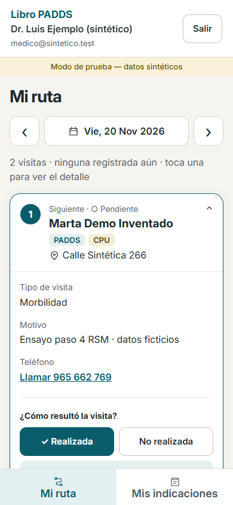
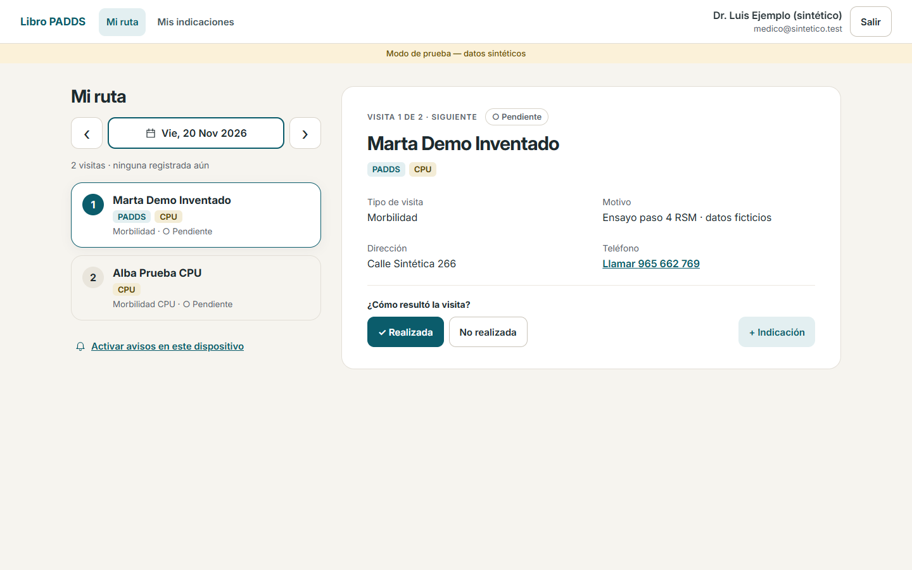
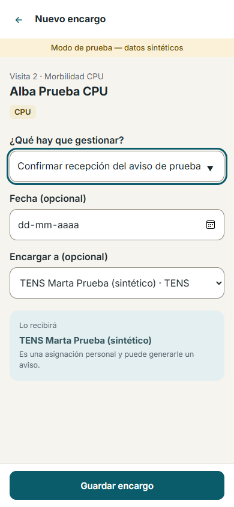

# Libro PADDS

Desarrollé Libro PADDS para organizar las visitas domiciliarias a personas con dependencia severa. Antes de salir, el equipo arma la ruta del día: selecciona a los pacientes, asigna cada visita a un profesional y ordena el recorrido.

## Mi ruta en el celular

Cada profesional abre **Mi ruta** para ver qué pacientes le toca visitar ese día y en qué orden. Al tocar una visita, puede consultar el domicilio y el motivo de la atención en terreno, sin llevar una lista en papel.

En este ejemplo ficticio hay dos visitas pendientes. La primera está abierta y muestra **Calle Sintética 266**. Desde esa misma pantalla, el profesional puede registrar el resultado de la visita. Si queda una tarea para otro integrante del equipo, puede asignarla y darle seguimiento.

## El recorrido de una curación

Ejemplo ficticio que ilustra el flujo del piloto.

| Momento | Qué ve o hace el equipo |
|---|---|
| Visita domiciliaria | El profesional registra que corresponde una curación, indica la fecha y asigna a la persona responsable. |
| Aviso en el celular | Quien recibe el encargo puede identificar la tarea pendiente. |
| Seguimiento desde el computador | El equipo consulta las indicaciones por gestionar y marca la tarea como cumplida cuando corresponde. |

## Capturas del modo de prueba

**La ruta en el computador.** El profesional consulta las dos visitas ficticias del día. Al seleccionar una, puede registrar el resultado de la visita o añadir una indicación.

**Un nuevo encargo desde el celular.** En la segunda visita, el profesional elige la tarea y revisa quién recibirá el aviso antes de guardar el encargo.

## Qué se probó

El 19 de noviembre de 2026, el equipo probó la agenda, la asignación de una curación, el aviso al celular y el seguimiento desde el computador con datos sintéticos. El alcance documentado es el de ese piloto de coordinación.

**Desarrollo:** Pablo Aguirre Araya, médico general de zona en Arica, Chile.
